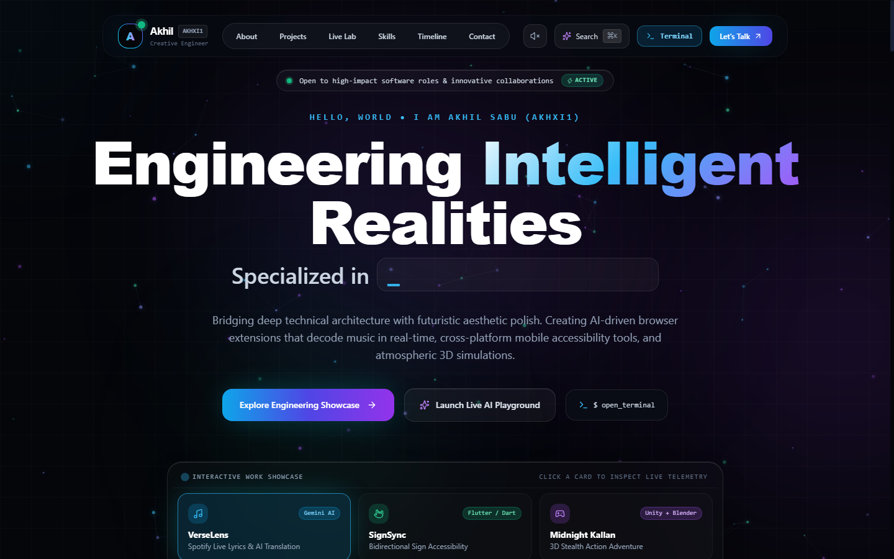
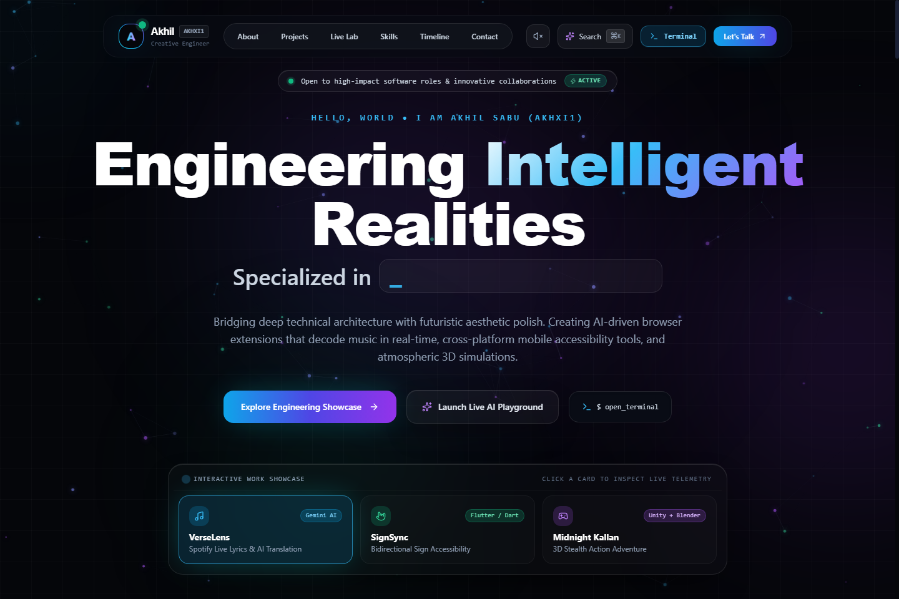

# Akhil Sabu | Creative Technologist & Software Engineer 🚀

An award-winning caliber developer portfolio engineered with **React 18**, **TypeScript**, **Tailwind CSS**, and **Vite**. Built to showcase high-impact engineering work spanning **AI-driven browser extensions (Google Gemini)**, **mobile accessibility solutions (Flutter)**, **immersive 3D stealth games (Unity & Blender)**, and **full-stack enterprise architectures**.

---

## 📸 Portfolio Visual Showcase

### 1. Hero & Cosmic Lighting Stage


### 2. About Akhil Sabu & SJCET Academic Foundation


### 3. Live Interactive Lab (VerseLens & SignSync)


### 4. Featured Innovations Bento Grid


### 5. Technical Arsenal & Contact Transmission Hub


---

## 🌿 Git Branches & Architecture

This repository maintains two distinct branches:

| Branch | Description | Tech Stack |
| :--- | :--- | :--- |
| **`main`** *(Active)* | The modern flagship portfolio with interactive canvas physics, live labs, terminal CLI, and bento showcase | React 18, TypeScript, Tailwind CSS, Vite |
| **`legacy-meyawo`** | Historical original portfolio archive from [AKHXI1/portfolio](https://github.com/AKHXI1/portfolio.git) | HTML5, Bootstrap 4, SCSS, JavaScript |

To explore or switch to the archived legacy version:
```bash
git checkout legacy-meyawo
```
To return to the modern flagship portfolio:
```bash
git checkout main
```

---

## ✨ Standout Features

- 🌌 **Interactive Starfield & Constellation Mesh**: Custom HTML5 2D Canvas with physics-based particle repulsion that reacts dynamically to mouse velocity at 60 FPS.
- 💡 **Dynamic Cursor Spotlight**: Smooth radial illumination that casts reflections against dark glass cards and reveals holographic borders.
- 🎛️ **Live Interactive Lab**:
  - **VerseLens Simulator**: Real-time Spotify lyric translation, Romanized phonetics for non-Latin songs, active animated audio equalizer canvas, and Google Gemini 1.5 Flash poetic analysis.
  - **SignSync Accessibility Workbench**: Interactive bidirectional sign language representation for the deaf and hard-of-hearing community with simulated camera landmark radar tracking.
- 🎓 **About Akhil Sabu Section**:
  - Highlights Computer Science engineering scholarship at **St. Joseph's College of Engineering and Technology (SJCET), Palai, Kottayam**.
  - Direct **"Download CV"** button that serves `public/resume.pdf` with confetti celebrations.
  - Authentic avatar artwork (`public/man.png`) and direct WhatsApp/Twitter channels.
- 💻 **Cyber Terminal Console (`>_ Terminal`)**: Full-featured interactive CLI with command history, autocomplete, easter eggs, and Matrix digital rain mode (`help`, `about`, `college`, `projects`, `skills`, `verselens`, `whatsapp`, `resume`, `matrix`, `confetti`, `sudo hire`).
- ⚡ **Command Palette (`Cmd+K` / `Ctrl+K`)**: Rapid keyboard navigation to jump between sections, trigger actions, download CV, or message on WhatsApp.
- 🔊 **Procedural Web Audio Engine**: Synthesized futuristic UI clicks, chimes, and frequency feedback with zero external audio assets.
- 🍱 **Bento-Grid Showcase (8 Projects)**: High-impact cards with category filters, live links, and deep-dive architecture inspection modals.

---

## 🛠️ Tech Stack

- **Frontend Core**: React 18, TypeScript, Vite
- **Styling**: Tailwind CSS, Glassmorphism 2.0, Syne & Plus Jakarta Sans typography
- **Icons & Graphics**: Lucide Icons, Custom SVGs, Canvas 2D Particle Engine
- **Audio**: Web Audio API Sound Synthesizer
- **Animation**: Canvas Confetti, Keyframe Equalizer Shimmer, Spotlight Physics

---

## 🚀 Getting Started

### 1. Install Dependencies
```bash
npm install
```

### 2. Start Development Server
```bash
npm run dev
```
Open [http://localhost:5173](http://localhost:5173) in your browser.

### 3. Build for Production
```bash
npm run build
```
Generates an optimized bundle in the `dist` directory.

### 4. Preview Production Build
```bash
npm run preview
```

---

## 👤 Author & Contact

- **Name**: Akhil Sabu
- **Institution**: St. Joseph's College of Engineering and Technology, Palai, Kottayam, Kerala
- **Degree**: B.Tech in Computer Science & Engineering
- **GitHub**: [@AKHXI1](https://github.com/AKHXI1)
- **WhatsApp**: [+91 8138902941](https://wa.me/8138902941)
- **Twitter / 𝕏**: [@Akhxi1S](https://twitter.com/Akhxi1S)
- **Email**: akhil.dev.work@gmail.com
